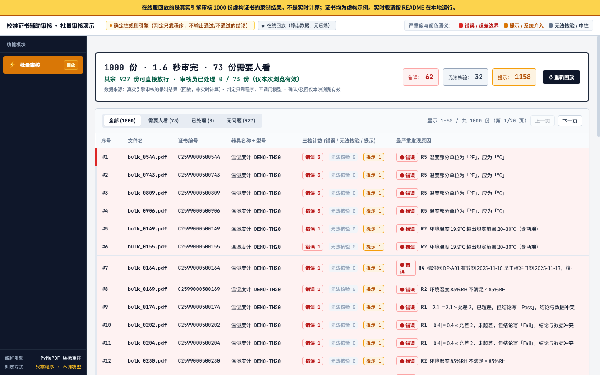
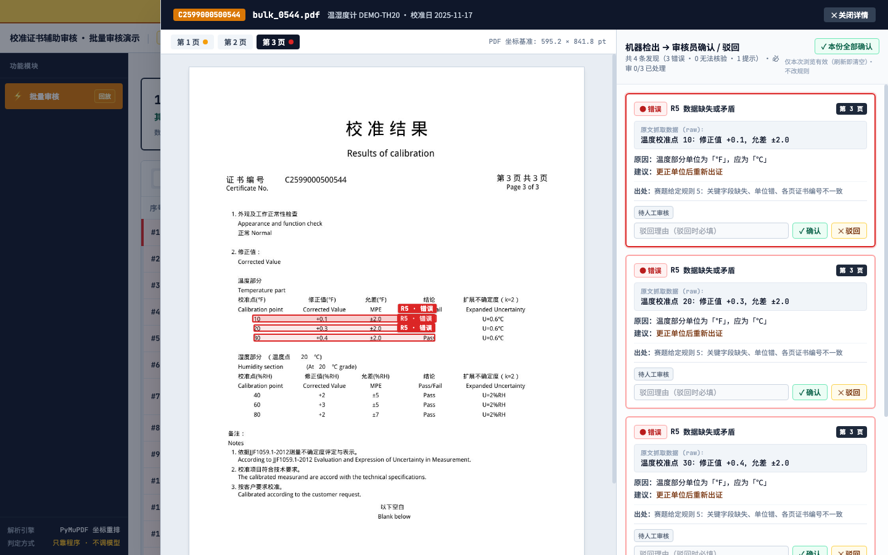

# 校准证书辅助审核：AI 起草规则，程序判定，人批准

一个批量审核校准证书的系统：1000 份证书几秒审完，有问题的标红置顶，审核员只需要点开那几十份。每条判定都由程序按人批准过的规则给出，能指到证书上的具体位置，AI 不直接下结论。

2026 年 10 月桃花岛 AI 黑客松（企业真题赛道）**第三名**作品的公开版。





**在线演示**：`<仓库发布后填入 GitHub Pages 地址>`
在线版回放的是真实引擎审核 1000 份虚构证书的录制结果，不是实时计算。实时版按下面三步在本地跑。

## 本地跑起来

在 Python 3.13 上验证过。

```bash
python -m venv .venv && source .venv/bin/activate
pip install -r requirements.txt

# 1. 审一份带错的示例证书，结果写到 app/out/
python -m app.cli tests/base/base_B_errors.pdf -o app/out --no-llm

# 2. 跑验收测试：39 个用例、67 条期望发现
python tests/run_acceptance.py --tag full

# 3. 造 1000 份证书，打开批量审核演示页 http://127.0.0.1:8765/
python tests/bulk/make_bulk.py --workers 10
python demo/server.py
```

还有一个逐份审核的界面：`python -m streamlit run app/审核台.py`，侧栏点「载入样例四份证书」。

---

## 问题

计量实验室每天要发出大量校准证书。写证书的校准员很多，负责核验和批准的审核员很少，而每份证书发出前都必须复核。审核员靠肉眼逐份核对修正值、允差、环境条件、标准器有效期，漏掉一条就是质量事故。

瓶颈在审核端：少数人要读完多数人的产出。

## 方案

对错由程序判，AI 只做体力活。

| 环节 | 谁做 | 做什么 |
|---|---|---|
| 写规则 | AI 起草，人批准 | 规则写成一份可读的配置（`app/rules.yaml`），每条带出处和边界说明，阈值人可以改 |
| 读证书 | 程序 | 按词坐标解析 PDF，抽出校准点、修正值、允差、环境条件、标准器（`app/parse.py`） |
| 判对错 | 程序 | 按规则逐条判定，每条发现带具体数字和证书上的位置（`app/rules.py`） |
| 拍板 | 审核员 | 逐条确认或驳回，驳回必须写理由 |

这样设计的原因：检测结论要可追溯、可复现，同一份证书跑两次结果必须一字不差，所以准确率不能押在模型上。读不出来的字段报「无法核验」交给人，不猜。

规则一共 8 条：超差与结论冲突、环境条件异常、校准点超范围、标准器过期、数据缺失或矛盾、与上一年证书的历史一致性、模板占位符残留、抽取不一致兜底。

## 价值

- **快**：1000 份证书，10 核 2.9 秒审完（比赛所用版式的证书，赛后实测）。本仓库的虚构证书是纯文字、文件更轻，同一台机器 1.5–1.6 秒，用上面第 3 步的脚本可以复现。
- **准**：39 个测试用例全部通过，67 条预期发现全部命中，零漏报、零误报。一半用例专门考「不该报」的边界，比如修正值刚好等于允差。
- **省人**：1000 份里需要人点开看的是 73 份，其余不用看。
- **不改现有流程**：直接审现成的 PDF，不需要替换出证系统。

## 测试怎么设计的

拿几份没有问题的证书当底板，每个用例只改一处，这样每个用例的标准答案是确定的，漏了能直接定位到是哪条规则。批量实测在此基础上造 1000 份：约 10% 带错、约 20% 是边界情况、50 对用来考历史对比。

- 验收报告：[`tests/report.md`](tests/report.md)
- 批量实测报告：[`tests/bulk/report.md`](tests/bulk/report.md)

## 已知局限

- 测试用例是我们自己出的题。它说明定义过的错误都能抓到、边界上不误报，不说明真实证书分布下的准确率。下一步是拿真实退回过的证书做盲测，这一步还没做。
- 「规则越用越准」只做了一半：驳回理由会留痕，阈值改一次全局生效；但驳回不会自动生成规则修订建议，这条闭环没有接通。
- 批量演示页的确认和驳回只存在本次运行的内存里，重启就没有。
- `app/llm_extract.py` 是可选的第二路大模型抽取，用来和程序解析交叉核对，默认关闭。本仓库所有数字都是不调模型跑出来的。

## 关于公开版

比赛用的证书、题目材料来自出题企业，不公开。本仓库里的证书全部由代码重新排版生成（`tests/tools/make_base.py`），实验室、委托方、仪器、编号、人员均为虚构，每页页脚标有「虚构示例证书，仅供演示」。规则引擎与比赛版本一致，39 个用例在虚构证书上重新跑过。

## 分工

- **PM（本仓库作者）**：选题、定总方案、写开工指令，驱动多个 AI 并行开发。三条线按目录隔离同时开工，约 1 小时出了可运行的系统。
- **后端队友**：本地化部署并跑通。
- **前端队友**：迭代多版界面。
- 引擎、审核台、测试的代码由 AI 编码 agent 和队友完成。

## 目录

```
app/      规则引擎、PDF 解析、命令行、逐份审核界面
tests/    虚构底板证书、39 个用例、验收脚本、1000 份批量实测
demo/     批量审核演示页（本地实时版，接真实引擎）
docs/     批量审核演示页（在线回放版）
```
